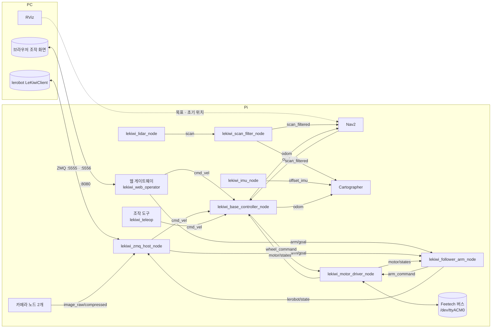
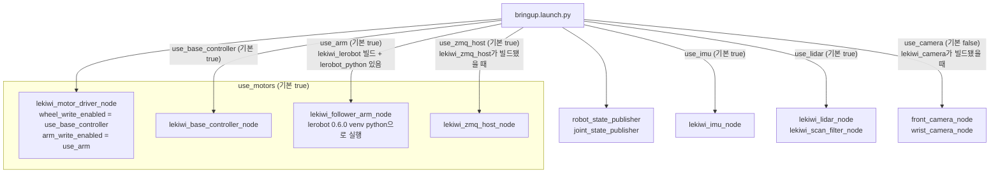
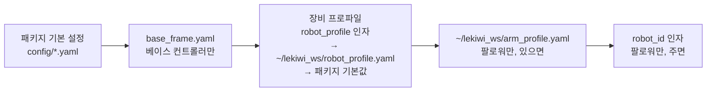
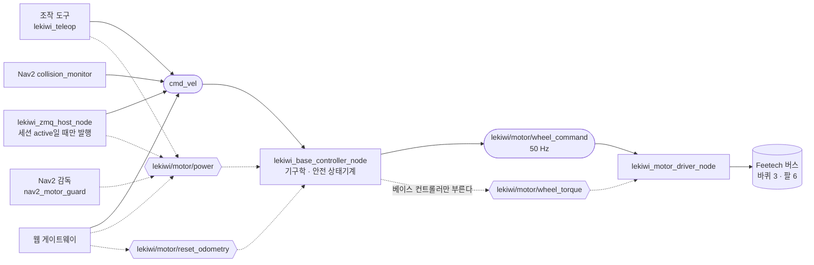
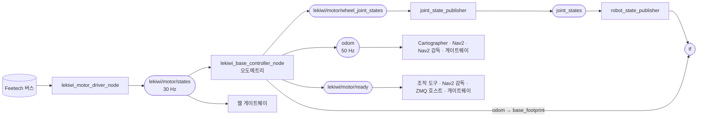
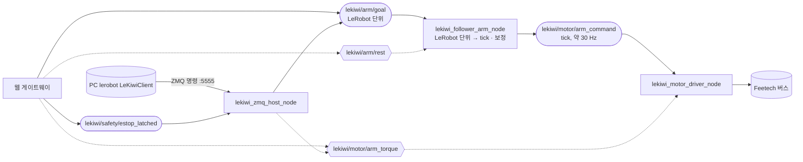
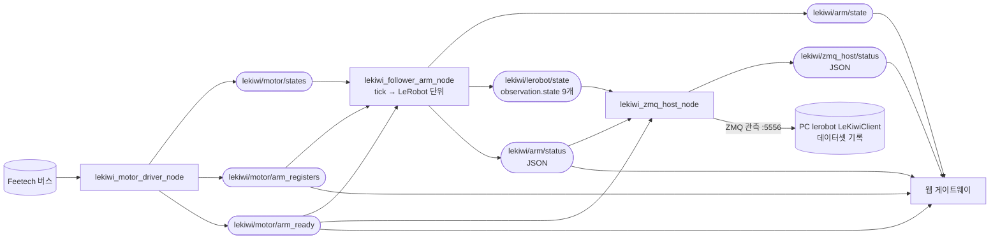
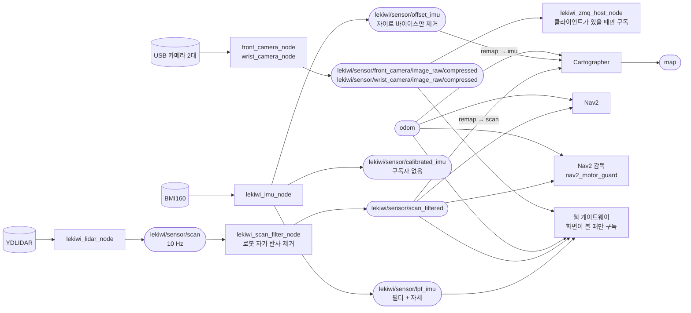
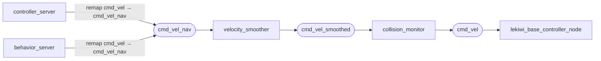
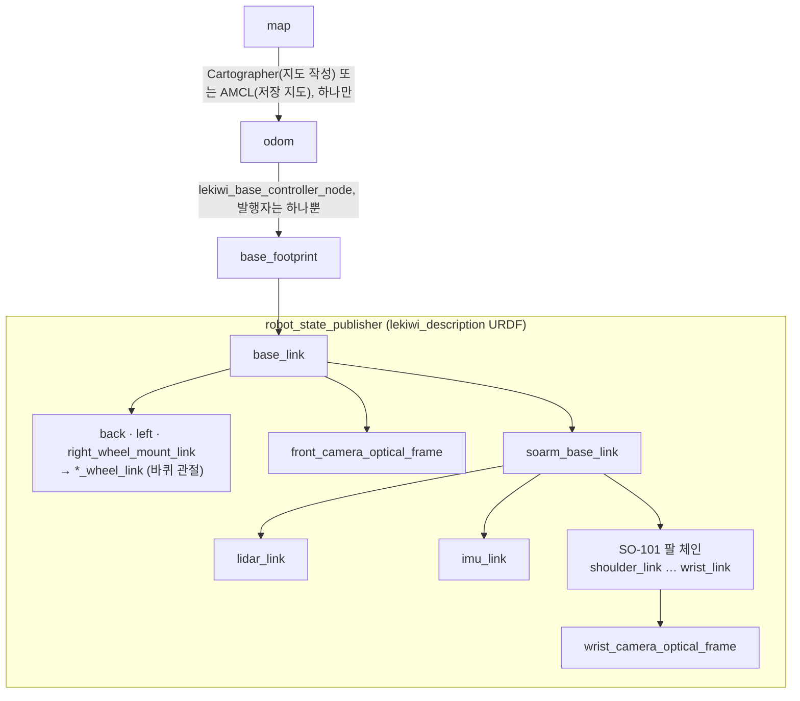

# 구조 그림 (노드 · 토픽 · launch · TF)

[interfaces.md](interfaces.md)의 표와 코드의 발행 · 구독 · 서비스 선언을 맞춰 보고 그린 그림이다 (main `7ea3da1` 기준).
QoS · 주기 · 동작의 자세한 뜻은 `interfaces.md`를 본다. 노드 · 토픽 이름을 바꾸면 이 파일도 함께 고친다.

GitHub, VS Code(Markdown 미리 보기 + Mermaid 확장)에서 그림으로 보인다.
웹 게이트웨이(`lekiwi_web_operator`, 이 워크스페이스 밖)의 연결은 그 저장소 `756c06f`의 코드를 보고 그렸다. 게이트웨이는 그림의 토픽 대부분을 웹 화면이 그 값을 볼 때만 구독한다.

| 모양 | 뜻 |
|------|----|
| 사각형 | ROS 노드 |
| 캡슐 | 토픽 (발행 → 토픽 → 구독) |
| 육각형 | 서비스 (점선: 부르는 쪽 → 서비스 → 서버) |
| 원통 | 장치 · ROS 밖 프로그램 |

## 1. 한눈에 보기

`cmd_vel`은 한 번에 발행자 하나만 둔다 (조작 도구 · 게이트웨이 · ZMQ 호스트 · Nav2 중 하나).

## 2. bringup이 켜는 노드

`lekiwi_bringup/launch/bringup.launch.py`. 바퀴 · 팔 토크는 켜지 않는다 (`lekiwi/motor/power`, `lekiwi/motor/arm_torque`로 켠다).

노드마다 파라미터를 넣는 순서. 오른쪽이 이긴다.

드라이버는 장비 프로파일 뒤에 `wheel_write_enabled` · `arm_write_enabled`를, ZMQ 호스트는 `zmq_cmd_port` · `zmq_obs_port` 인자를 얹는다.

## 3. 바퀴 (주행) 경로

명령 (모터 쪽으로 내려가는 흐름)

사람 · 도구는 드라이버의 `wheel_torque`가 아니라 `lekiwi/motor/power`를 부른다. 베이스 컨트롤러의 안전 상태기계를 거치게 하기 위해서다.

상태 (모터에서 올라오는 흐름)

## 4. 팔 경로

팔 토픽 · 서비스(`arm_command`, `arm_ready`, `arm_registers`, `arm_torque`)는 `use_arm:=true`일 때만 생긴다.

명령

상태

ZMQ 호스트는 세션의 첫 팔 명령 때만 `arm_torque` true를 부른다. 게이트웨이는 bringup을 끄기 전에 `arm/rest` → `rested`를 본 뒤 `arm_torque` false를 부른다.

## 5. 센서 · 지도

## 6. Nav2 명령 경로

`lekiwi_navigation2/launch/navigation.launch.py`. 바퀴로 가는 명령은 `collision_monitor`만 `cmd_vel`로 낸다.

## 7. TF

`lidar_link` · `imu_link`는 bringup이 `use_hardware_sensors:=true`로 URDF를 만들 때만 생긴다.
